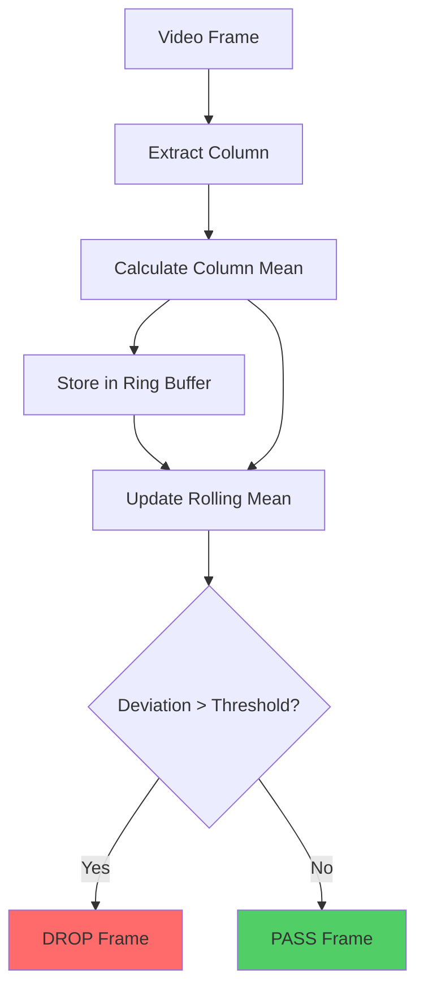
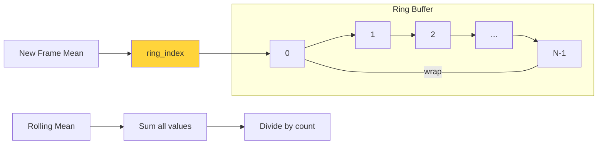

# Rolling Sum Filter - Design Document

## Overview

A GStreamer element that drops frames based on rolling mean analysis of a single column of pixels. Inspired by the detection algorithm in `cli.py`, simplified for real-time streaming.

## Element Name

**`rollingsum`** - Transform element that analyzes pixel values and selectively drops frames

## Purpose

Monitor a vertical column of pixels in video frames, calculate the rolling mean over a time window, and drop frames when the current frame's column mean deviates significantly from the rolling mean baseline.

## Architecture

### Base Class
- Inherits from `GstBaseTransform` (similar to [`select`](gst/select/gstselect.c))
- In-place transform (analysis only, no frame modification)
- Returns `GST_BASE_TRANSFORM_FLOW_DROPPED` to drop frames
- Returns `GST_FLOW_OK` to pass frames

### Element Structure

```c
struct _GstRollingSum
{
  GstBaseTransform element;
  
  /* Properties */
  gint window_size;      // Number of frames in rolling window (default: 1000)
  gint column_index;     // Which column to analyze (default: 1, second column)
  gint stride;           // Row sampling stride (default: 1, every row)
  gdouble threshold;     // Deviation threshold for dropping (default: 0.5)
  
  /* State */
  gdouble *ring_buffer;  // Circular buffer of column means
  gint ring_index;       // Current position in ring buffer
  gint frame_count;      // Total frames processed
  gdouble rolling_mean;  // Current rolling mean
};
```

## Algorithm (Simplified from cli.py)

### Per Frame Processing

```
1. Extract column data:
   - Select column at column_index
   - Sample every stride rows
   - Calculate mean of sampled pixels: frame_mean
   
2. Update ring buffer:
   - Store frame_mean in ring_buffer[ring_index]
   - Increment ring_index (wrap around)
   
3. Calculate rolling mean:
   - Sum values in ring buffer (up to window_size or frame_count)
   - Divide by actual window size
   
4. Calculate deviation:
   - deviation = abs(frame_mean - rolling_mean)
   
5. Decision:
   - If deviation > threshold: DROP frame
   - Else: PASS frame
```

### Key Simplifications from cli.py

- **No EMA tracking**: Use simple rolling mean instead of exponential moving average
- **No variance tracking**: Use fixed threshold instead of dynamic variance-based detection
- **No recording logic**: Just drop/pass, no buffering for output segments
- **No patience mechanism**: Immediate decision per frame

## Properties

| Property | Type | Default | Range | Description |
|----------|------|---------|-------|-------------|
| `window-size` | int | 1000 | 1-100000 | Number of frames in rolling window |
| `column-index` | int | 1 | 0-width | Which vertical column to analyze |
| `stride` | int | 1 | 1-height | Row sampling stride (1=all rows) |
| `threshold` | double | 0.5 | 0.0-1.0 | Normalized deviation threshold for dropping |

## Data Structures

### Ring Buffer
- Array of doubles sized to `window_size`
- Stores column mean for each processed frame
- Circular wrapping via modulo: `ring_index % window_size`

### Frame Analysis
```
For column_index=1, stride=1, frame height=H:
- Extract pixels: frame[:, column_index]
- Sample: frame[::stride, column_index]
- Count: H / stride samples
- Mean: sum(samples) / count
```

## Implementation Files

### Directory Structure
```
gst/rollingsum/
├── CMakeLists.txt
├── gstrollingsum.c
└── gstrollingsum.h
```

### gstrollingsum.h
- Element type definitions
- Structure declarations
- Property enums
- Function prototypes

### gstrollingsum.c
- GObject methods (init, dispose, get/set properties)
- GstBaseTransform methods (transform_ip)
- Helper functions (extract_column_mean, update_rolling_mean)
- Plugin registration

### CMakeLists.txt
- Build configuration (copy from [`gst/select/CMakeLists.txt`](gst/select/CMakeLists.txt))
- Link GStreamer base and video libraries

## Video Format Support

### Initial Implementation
- **Primary target**: Grayscale (GRAY8, GRAY16)
- **Secondary**: Bayer formats (common in machine vision)

### Caps Filter
```c
static GstStaticPadTemplate sink_template =
  GST_STATIC_PAD_TEMPLATE ("sink",
    GST_PAD_SINK,
    GST_PAD_ALWAYS,
    GST_STATIC_CAPS (
      "video/x-raw, format=(string){GRAY8,GRAY16_LE,GRAY16_BE}; "
      "video/x-bayer, format=(string){bggr,grbg,gbrg,rggb}"
    )
  );
```

## Pipeline Usage Examples

### Basic Usage
```bash
gst-launch-1.0 idsueyesrc config-file=config.ini ! \
    rollingsum window-size=1000 column-index=1 threshold=0.5 ! \
    autovideosink
```

### Custom Configuration
```bash
gst-launch-1.0 idsueyesrc config-file=config.ini ! \
    rollingsum window-size=5000 column-index=320 stride=2 threshold=0.3 ! \
    queue ! \
    autovideosink
```

### With Format Conversion
```bash
gst-launch-1.0 idsueyesrc ! \
    videoconvert ! \
    video/x-raw,format=GRAY8 ! \
    rollingsum ! \
    autovideosink
```

## Performance Considerations

### Memory Usage
- Ring buffer: `window_size * sizeof(double)` = ~8KB for default 1000 frames
- Minimal per-frame allocation

### CPU Usage
- Column extraction: O(height/stride)
- Rolling mean update: O(1) using incremental sum
- Very lightweight compared to full-frame processing

### Optimization Opportunities
1. **Incremental mean**: Track sum instead of recalculating
2. **SIMD**: Vectorize column summation
3. **Skip calculation**: Only recalc every N frames if baseline is stable

## Testing Strategy

### Unit Tests
- Ring buffer wrapping
- Mean calculation accuracy
- Threshold comparison logic

### Integration Tests
- Pipeline with videotestsrc
- Pipeline with idsueyesrc
- Frame drop verification
- Property changes during playback

### Test Cases
1. Static video (all frames similar) → all pass
2. Single bright frame → that frame drops
3. Gradual change → frames pass
4. Periodic pattern → pattern frames drop

## Future Enhancements

### Phase 2 (If Needed)
- Add EMA baseline tracking (like cli.py)
- Add variance-based thresholds
- Support multiple columns or regions
- Add metadata output (tag frames with deviation values)
- RGB format support (analyze specific channel)

### Phase 3 (Advanced)
- Full cli.py recording logic
- Buffer and output segments
- Integration with probe detection systems

## Integration with Existing Project

### Build System
Update [`gst/CMakeLists.txt`](gst/CMakeLists.txt):
```cmake
add_subdirectory (rollingsum)
```

### Documentation
Update [`README.md`](README.md):
- Add rollingsum to "Other elements" section
- Add pipeline example

## Mermaid Diagram: Data Flow



## Mermaid Diagram: Ring Buffer Operation



## Implementation Checklist

- [ ] Create gst/rollingsum directory
- [ ] Implement gstrollingsum.h
- [ ] Implement gstrollingsum.c
- [ ] Create CMakeLists.txt
- [ ] Update gst/CMakeLists.txt
- [ ] Build and test basic functionality
- [ ] Test with idsueyesrc
- [ ] Update README.md
- [ ] Create feature branch
- [ ] Commit and document

## References

- Original algorithm: `cli.py` lines 64-79 (column extraction and mean comparison)
- Template element: [`gst/select/gstselect.c`](gst/select/gstselect.c)
- GStreamer base transform: [GstBaseTransform documentation](https://gstreamer.freedesktop.org/documentation/base/gstbasetransform.html)