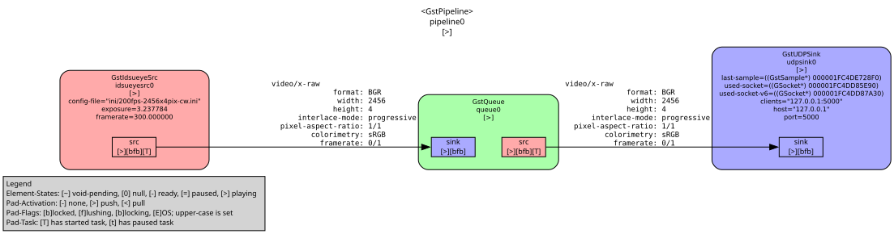

# gst-plugins-vision

GStreamer plugins for IDS uEye cameras with frame analysis capabilities.

#### TODO
 - []  idsueyesrc doesnt respect auto exposure set in ini file. need to be set in filter  `exposure=0.5`
 - []  


## Supported Elements

### Image Acquisition
- **idsueyesrc**: Video source for [IDS uEye cameras][1] (GigE Vision, USB 2/3, USB3 Vision)

### Video Analysis
- **rollingsum**: Drops frames based on rolling mean analysis of a single column. Analyzes pixel column deviation from rolling baseline to detect anomalies or changes in the scene.


## Usage Examples

### Basic capture from IDS uEye camera
```powershell
gst-launch-1.0 idsueyesrc config-file=ini/whole-presacler64_autoexp-binningx2.ini exposure=0.5 ! queue ! autovideosink
```

## WIP - Frame filtering based on column analysis
Drop frames when column mean deviates from rolling baseline by more than 0.5:
```powershell
gst-launch-1.0 idsueyesrc config-file=ini/whole-presacler64_autoexp-binningx2.ini exposure=0.5 ! videoconvert ! video/x-raw,format=GRAY8 ! rollingsum window-size=1000 column-index=1 threshold=0.5 ! queue ! autovideosink
```

**Note:** The `rollingsum` element analyzes a single column of pixels and drops frames when the column mean deviates from the rolling mean baseline by more than the threshold. Use `videoconvert` to ensure proper format negotiation.

### Additional rollingsum examples

Analyze column 320 with larger window:
```powershell
gst-launch-1.0 idsueyesrc config-file=ini/whole-presacler64_autoexp-binningx2.ini exposure=0.5 ! videoconvert ! video/x-raw,format=GRAY8 ! rollingsum window-size=5000 column-index=320 threshold=0.3 ! queue ! autovideosink
```

Use stride for faster processing (sample every 2 rows):
```powershell
gst-launch-1.0 idsueyesrc config-file=ini/whole-presacler64_autoexp-binningx2.ini exposure=0.5 ! videoconvert ! video/x-raw,format=GRAY8 ! rollingsum window-size=1000 column-index=1 stride=2 threshold=0.5 ! queue ! autovideosink
```

Lower threshold for more sensitive detection:
```powershell
gst-launch-1.0 idsueyesrc config-file=ini/whole-presacler64_autoexp-binningx2.ini exposure=0.5 ! videoconvert ! video/x-raw,format=GRAY8 ! rollingsum threshold=0.2 ! queue ! autovideosink
```

## Network Streaming

### Quick Start - Single Line Transmission (2456x1)

#### Send Single Line via UDP
Extract and transmit one line from camera (daytime, 200fps):
```powershell
gst-launch-1.0 idsueyesrc config-file=ini/200fps-2456x4pix-cw.ini exposure=5 framerate=200 `
    ! videocrop bottom=3 `
    ! queue `
    ! udpsink host=127.0.0.1 port=5000
```

#### Receive and Display
```pwsh
uv run .\scripts\recv_raw_rolling.py --display-fps 60
```

**What's happening:**
- Camera captures 2456x4 pixels at row 500 of the sensor
- `videocrop bottom=3` extracts only the top line (2456x1)
- 7368 bytes transmitted per frame (2456 × 1 × 3 BGR channels)
- Receiver displays as a rolling vertical scan

See [network_guide.md](network_guide.md) for detailed configuration options, nighttime settings, and recording.

### Demo/Test Data Streaming

#### Sender (crop to first column, send raw over UDP)
```pwsh
gst-launch-1.0 -v `
    videotestsrc pattern=smpte ! `
    videocrop left=0 right=639 top=0 bottom=0 ! `
    video/x-raw,format=RGB,width=1,height=640,framerate=30/1 ! `
    udpsink host=127.0.0.1 port=5000
```

#### GStreamer Receiver (raw UDP → display)
```pwsh
gst-launch-1.0 -v `
    udpsrc port=5000 caps="video/x-raw,format=RGB,width=1,height=640,framerate=30/1" ! `
    videoconvert ! `
    autovideosink
```

## Dependencies

- GStreamer 1.2.x or newer
- IDS uEye SDK (for camera support)

## Building on Windows

### Quick Start with PowerShell Script

The easiest way to build is using the provided PowerShell script:

```powershell
# Set the plugin installation path
$env:GST_PLUGIN_PATH = "C:\path\to\your\plugins"

# Build all plugins (IDS uEye + rollingsum) and auto-copy to GST_PLUGIN_PATH
.\build.ps1
```

For more options, see:
```powershell
Get-Help .\build.ps1 -Detailed
```

### Manual Build Process

If you prefer to build manually:

1. Install [CMake](https://cmake.org/)
2. Install [GStreamer distribution](https://gstreamer.freedesktop.org/download/) (default path: `C:\bin\gstreamer\1.0\msvc_x86_64`)
3. Install [IDS uEye SDK](https://www.ids-imaging.com) (default path: `C:\Program Files\IDS\uEye\Develop`)
4. Run:

```powershell
git clone https://github.com/joshdoe/gst-plugins-vision.git
cd gst-plugins-vision
mkdir build
cd build
cmake .. -G "Visual Studio 16 2019" -A x64 -DGSTREAMER_ROOT="C:\bin\gstreamer\1.0\msvc_x86_64"
cmake --build . --config Release
```

### Installation

The `build.ps1` script automatically copies plugins to `$env:GST_PLUGIN_PATH` if set. Alternatively:

1. Set `GST_PLUGIN_PATH` environment variable to point to your plugin directory
2. Copy the built DLLs manually:
   - `build\sys\idsueye\Release\libgstidsueye.dll`
   - `build\gst\rollingsum\Release\libgstrollingsum.dll`

### Verify Installation

```powershell
gst-inspect-1.0 idsueyesrc
gst-inspect-1.0 rollingsum
```

## Documentation

- [Rolling Sum Filter Design](DESIGN_ROLLINGSUM.md)

## Debugging
add `$env:GST_DEBUG_DUMP_DOT_DIR='.'` 



to get dotfile, and view using https://dreampuf.github.io/GraphvizOnline/, or
```pwsh
dot -Tsvg C:\dev\gst-plugins-vision\0.00.02.922833100-gst-launch.PAUSED_PLAYING.dot -o same.svg
```